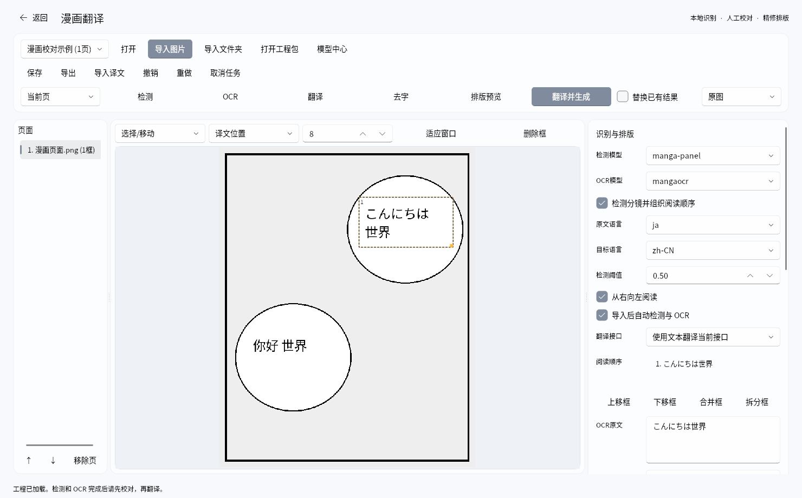
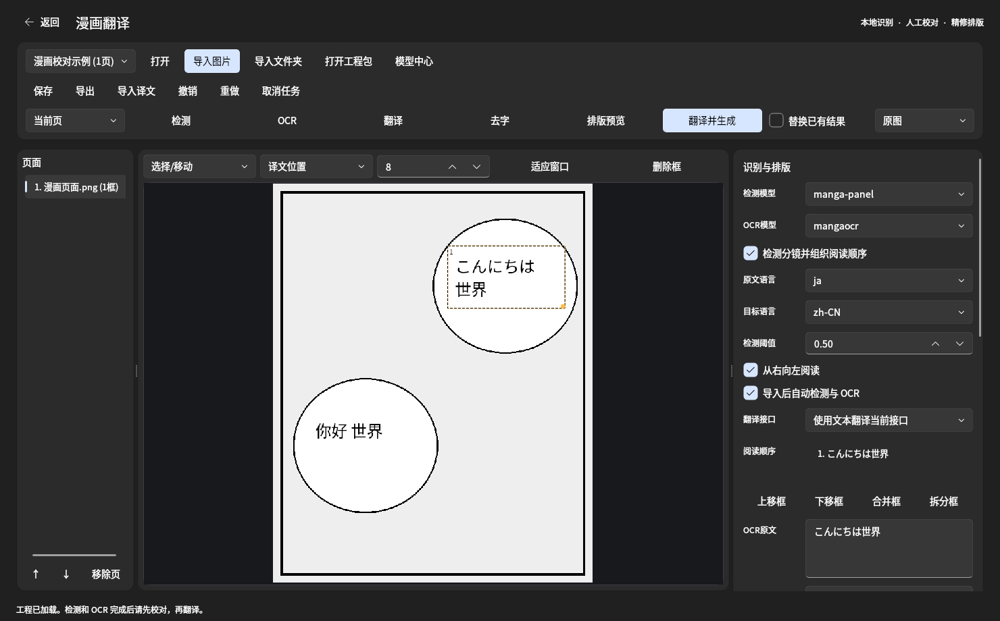

# 漫画翻译工作区

侧栏新增 **漫画翻译**。这是 AiNieePlus 内的独立本地工作区，不依赖 ImageTrans、Java 或闭源 JAR；原有“图片翻译”的整图生图模式仍可使用。

首页复用 AiNiee 的导入卡片和最近工程列表；编辑区采用相同的 Fluent 控件、主题色、卡片和明暗主题。





## Windows x86-64 安装包

在 Fork 的 GitHub Releases 中选择 `AiNieePlus-Windows-x64-Setup.exe`。这是 64 位版本，包含前后端、核心模型与字体；按当前用户安装，无需管理员权限。安装版使用标准用户数据目录，便携 ZIP 使用程序目录。发布页同时提供 SHA256 清单。

推送 main 会触发 Windows 构建、漫画测试、离线资源核对、安装包编译和安装后运行检查。手动运行工作流时可额外选择 macOS。每次成功构建创建独立预发布版本，保留先前发布记录。

## 使用顺序

1. 从图片或文件夹创建工程。默认用 manga-panel 定位文字与分镜，再用 mangaOCR 识别日文；在这里暂停，等待人工校对。
2. 在右侧选择检测器、OCR、语言和翻译接口。翻译默认继承 AiNiee 的文本翻译接口，也可选择单独的接口。接口配置仍在原有“接口管理”中维护，本功能不包含大语言模型权重。
3. 校对原文、删除误检框，或选择“建立OCR框”拖出新区域，再对选中框运行 OCR。分镜类别只用于阅读顺序，不作为文字框进行 OCR。
4. 分别调整 **OCR区域、擦除区域、译文位置**。滚轮缩放，中键拖动平移；框的右下角可改变尺寸。框可合并、拆分，原文、译文和几何位置可分别锁定。
5. 点击“翻译”或“翻译并生成”。文字通过原有 AiNiee 的分批、提示词、术语表、请求器与译文校验流程处理。默认保留已有译文；“替换已有结果”用于明确重做。
6. 修改字体、字号、最小字号、横竖排、描边、颜色、行距、字距、对齐、旋转。样式可应用到本页或全部页。原图、成品、去字图、蒙版和文字层可切换查看。超出文字框时会提示。
7. 导出 PNG、JPEG、整批 ZIP、可编辑 `.manga.zip` 工程包，或以文字框 ID 为键的 i18next JSON。JSON 可交给 AiNiee 文本翻译后，通过“导入译文”按 ID 回填。未知 ID 会拒绝导入，锁定译文保持不变。

工程自动保存；撤销和重做不会回退服务端版本。任务期间的人工修改先保留在编辑器，后台结果回来后按字段合并再保存。任务可取消，单次正在执行的模型推理会先安全结束。导出先生成到临时目录，检查重名后再发布，不覆盖既有成品。

## 去字方式

- **色块遮挡**：自动从擦除区域边缘取色，也可指定颜色。适合纯色气泡。
- **精准去字（LaMa）**：在擦除区域内提取文字像素蒙版，再进行修复；画笔增加蒙版，橡皮保护不应修复的部分。阈值提取不是语义分割，复杂背景需要人工检查蒙版。修复结果只写回蒙版中的像素。
- **保留原文**：保留该框原图内容，只叠加译文。

## 核心与扩展模型

| 模型 | 用途 | 安装方式 |
| --- | --- | --- |
| manga-panel YOLO26 | 文字框与分镜；类别 1 为文字、0 为分镜 | 完整发布包内置，使用作者的同一 ONNX 导出 |
| mangaOCR ONNX | 日文单框识别，支持横竖排 | 完整发布包内置，同一 encoder / decoder / vocab |
| RapidOCR PP-OCRv6 | 通用中英文识别 | 完整发布包内置，固定 RapidOCR 3.10.0 的三组权重 |
| LaMa Manga ONNX | 复杂背景修复 | 完整发布包内置；采用公开漫画修复权重，不是 ImageTrans 的 int8 big-lama 文件 |
| Legacy YOLOv4 | 旧版气泡检测 | 模型中心导入 ImageTrans 目录或包含 cfg、weights、json 的模型目录 |
| Koharu RFDETR 版面分割 | 作者提供的扩展模型 | 模型中心提供来源与用途；本版尚未适配其分割输出，不能用于检测 |

核心模型共约 390 MB（含字体；不含大语言模型）。模型中心提供来源、用途、目录导入、下载、断点续传与 SHA256 校验。下载结果必须与 `source-lock.json` 中的已验证版本一致；不会静默替换模型或回退到在线 OCR。当前推理使用 CPU；GPU 和其余扩展检测架构不在本版适配范围。

Legacy 权重不放进公开发布包。本机开发版本可导入现有权重；这不会读取或修改 ImageTrans 的程序文件。

## 开发与打包

安装原项目的前后端依赖后，准备公开资源：

```powershell
python -m Tools.prepare_manga_models --download
# 也可以优先复用同一公开权重：
python -m Tools.prepare_manga_models --source 'D:\path\to\ImageTrans' --download
python -m Tools.prepare_manga_models --check
```

正常通过 `python AiNiee.py` 启动。仅预览漫画页面时，在两个终端分别运行：

```powershell
python -m Backend --port 33899
python -m Tools.manga_preview --url http://127.0.0.1:33899
```

后端复用原有 image 队列、作业记录和取消接口；漫画 REST 路由位于 `/api/v2/manga`，沿用后端访问令牌。检测、OCR、修复和排版在独立进程执行，界面通过后台线程通信，不直接加载推理库。

核心权重与字体不提交到 Git，由资源准备步骤获取，打包时整体收入 `Backend/resources/manga`。Windows 和 macOS 工作流都已加入该步骤；发布前检查缺失文件、固定指纹、ONNX 输入与字体可加载性。Windows 安装包还会在干净目录静默安装，检查 EXE 架构和无系统 PATH 时的运行库加载。

```powershell
python -m pytest tests -q
python -m Tools.smoke_manga --output build/manga-smoke
```

真实模型冒烟验证包含 YOLO26、mangaOCR、RapidOCR、LaMa、独立进程和 PNG 导出；`--legacy <模型目录>` 可增加旧版权重加载测试。自动测试中的大语言模型回复是受控数据，不会调用付费接口。

## 资源来源

- 检测器与导出配置：[xulihang/balloon-dataset](https://github.com/xulihang/balloon-dataset)
- YOLO26 原始权重与 AGPL 声明：[leoxs22/manga-panel-detector-yolo26n](https://huggingface.co/leoxs22/manga-panel-detector-yolo26n)
- mangaOCR ONNX：[xulihang/mangaocr-onnx](https://github.com/xulihang/mangaocr-onnx)，原始模型：[kha-white/manga-ocr](https://github.com/kha-white/manga-ocr)
- RapidOCR：[RapidAI/RapidOCR](https://github.com/RapidAI/RapidOCR)
- LaMa 漫画模型与 Apache 声明：[mayocream/lama-manga-onnx](https://huggingface.co/mayocream/lama-manga-onnx)
- 字体：[Noto CJK](https://github.com/notofonts/noto-cjk)，OFL 文本随资源提供。

模型转换来源与原始权重来源分开记录；没有将 ImageTrans 的闭源代码或 JAR 放入本项目。
